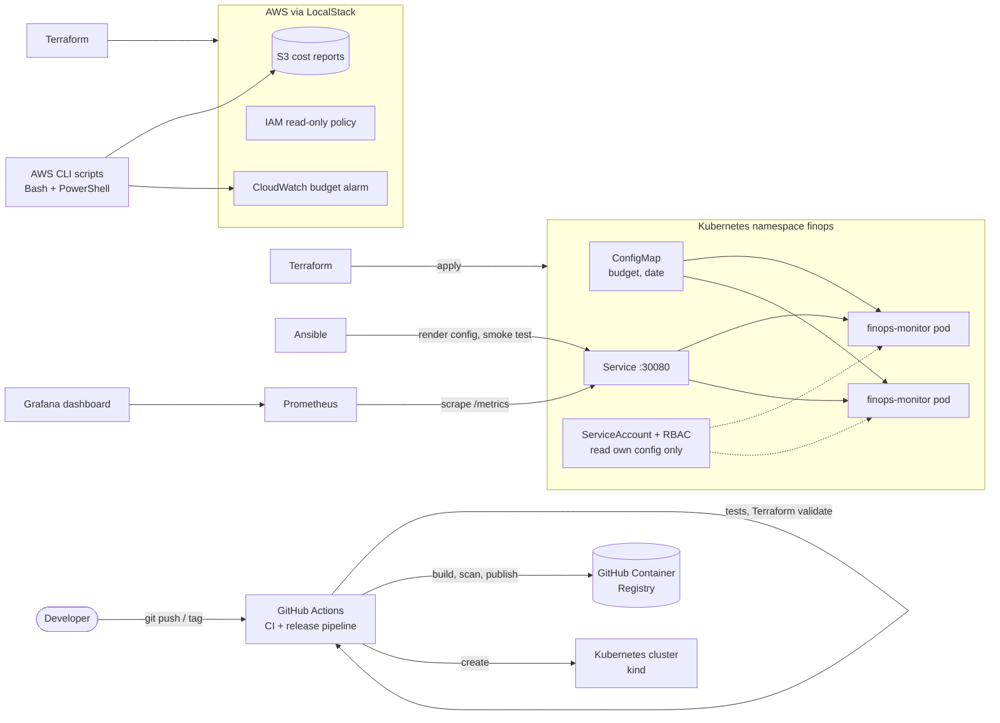
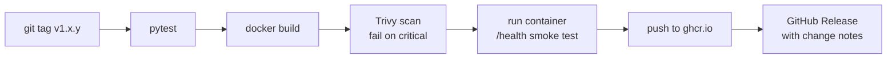

# FinOps Cloud Cost Monitor: DevOps pipeline on Kubernetes

A small cloud cost (FinOps) service, packaged and run the way a DevOps team would:
Docker image → Kubernetes cluster → deployed with **Terraform** → configured and smoke-tested with
**Ansible** → monitored with **Prometheus and Grafana** → built by a **Jenkins** pipeline and **GitHub Actions**.
It also exports a **Power BI** star schema for cost dashboards.

> **Data note:** the cost data is **generated sample data** shaped like an AWS Cost and Usage Report.
> No AWS account or real bill is used.

## Architecture



## Release process



`.github/workflows/release.yml` runs this when a version tag is pushed or a release is started from the Actions tab with a version number, so every release is tested, scanned, smoke-tested and published the same way.

## What the service does (FinOps)

| Question | How |
|---|---|
| What are we spending, by service, team and environment? | Cost breakdowns |
| Will we go over budget this month? | Month-to-date + forecast from the last 7 days, budget status ok / warning / over |
| Any unusual days? | Rolling z-score anomaly detection (finds the planted spike on 2026-10-18) |
| Who owns the spend? | Share of untagged cost (8%) |
| Where can we save? | Rightsizing: idle instances to stop or downsize, with monthly savings |

Endpoints: `/health`, `/api/summary` (JSON), `/metrics` (Prometheus).

## DevOps pieces

| File | Tool | What it does |
|---|---|---|
| `Dockerfile` | Docker | Small non-root image with a health check |
| `kind-config.yaml` | Kubernetes (kind) | Local cluster; port 30080 reaches the service |
| `terraform/` | Terraform | Infrastructure as code: namespace, ConfigMap, Deployment (2 replicas, probes, resource limits, read-only filesystem), NodePort Service |
| `terraform/rbac.tf` | Kubernetes RBAC | Least privilege: the app's ServiceAccount + Role + RoleBinding can only `get` its own ConfigMap (checked with `kubectl auth can-i`) |
| `terraform-aws/` | Terraform + AWS | S3 bucket for cost reports (private, encrypted, versioned), least-privilege IAM read policy + user for Power BI, CloudWatch alarm when the forecast is over budget. Runs on **LocalStack** (AWS emulator) by default, so no AWS bill |
| `scripts/publish_costs.sh` / `.ps1` | AWS CLI (Bash / PowerShell) | Uploads the Power BI files to S3 and sends the month forecast to CloudWatch as a custom metric |
| `docs/powerbi.md` | Power BI | Step-by-step dashboard build with DAX measures |
| `k8s/finops-monitor.yaml` | Kubernetes | The same resources as plain manifests |
| `ansible/site.yml` | Ansible | Renders per-environment Terraform settings (dev / test / prod), checks tools are installed, smoke-tests the live service |
| `monitoring/` + `docker-compose.yml` | Prometheus, Grafana | Scrapes the metrics; Grafana dashboard with forecast, budget, untagged share, savings, cost by service and team |
| `Jenkinsfile` | Jenkins | Pipeline: test → build image → cluster → configure → Terraform deploy → smoke test |
| `scripts/publish_costs_azure.sh` | Azure CLI, Azure Blob Storage | Uploads the Power BI files to a private Blob container; runs against **Azurite** (Microsoft's Azure Storage emulator) in CI, or real Azure with a connection string |
| `.github/workflows/release.yml` | GitHub Actions, GHCR, Trivy | Release pipeline: on a version tag, test, build, scan, smoke-test and publish the image, then create a GitHub Release |
| `.github/workflows/ci.yml` | GitHub Actions | Runs all of the above automatically on every push (see below) |
| `app/report.py` | Power BI | Writes `fact_cost.csv` + `dim_service`, `dim_team`, `dim_date` and `rightsizing.csv` for a Power BI model |

## Proof it works: GitHub Actions

Every push runs five jobs on GitHub's machines:

1. **test**: 19 pytest tests, Ansible syntax check, Terraform validate (Kubernetes and AWS), ShellCheck, Docker build
2. **deploy-kubernetes**: creates a real Kubernetes cluster (kind), loads the image, runs Ansible, deploys with Terraform, waits for the rollout, checks RBAC with `kubectl auth can-i` (allowed: read own config; denied: secrets, pods, deployments, other namespaces), then Ansible smoke-tests the live service
3. **monitoring**: starts the app, Prometheus and Grafana, and checks Prometheus is scraping the app and Grafana loaded the dashboard

4. **aws-localstack**: starts LocalStack, creates the S3 bucket, IAM policy/user and CloudWatch alarm with Terraform, checks them with the AWS CLI, runs `publish_costs.sh`, and waits until the CloudWatch alarm goes to **ALARM** (forecast $27,848 > budget $25,000)

5. **azure-azurite**: starts Azurite (Microsoft's Azure Storage emulator) and uploads the Power BI files to Azure Blob Storage with the Azure CLI

A green ✓ in the **Actions** tab means all of it worked.

## Run it on Windows (Command Prompt)

Python part (no Docker needed):

```
python -m venv .venv
.venv\Scripts\activate
pip install -r requirements.txt -r requirements-dev.txt
pytest -q
python -m app.report
```

`python -m app.report` prints the cost report and writes the Power BI CSV files into `powerbi\`.

Optional, with Docker Desktop installed: `docker compose up -d --build`, then open
http://localhost:3000 (Grafana, admin / admin) → Dashboards → FinOps.

## Terms in plain language

- **DevOps**: automating how software is built, tested, deployed and run.
- **Docker image / container**: the app packed with everything it needs, so it runs the same everywhere.
- **Kubernetes**: runs containers, restarts them if they fail and keeps the requested number running.
- **Infrastructure as code (Terraform)**: describing servers and deployments in files instead of clicking.
- **Configuration management (Ansible)**: setting up and checking systems from a script, the same way every time.
- **CI/CD (Jenkins, GitHub Actions)**: every change is tested and deployed automatically.
- **Prometheus / Grafana**: collect numbers (metrics) from the app and show them on dashboards.
- **FinOps**: managing cloud spending: who spends what, forecasts, budgets and savings.
